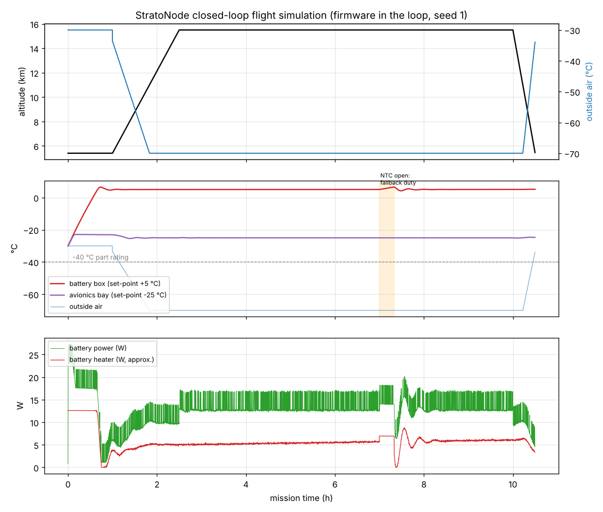

# StratoNode: avionics power & telemetry node for stratospheric UAVs

A flight-computer-class board for a fixed-wing UAV cruising at **50,000 ft (15.5 km), -70 °C,
15% sea-level air density**: input protection and hold-up, a 5 V / 3 A buck and 3V3 LDO,
firmware-controlled load shedding, two heater channels (battery box and avionics bay), an
STM32G474 (Cortex-M4F, CAN-FD), a barometer good to 10 mbar, and GNSS (GPS + NavIC), telemetry,
payload and CAN harness connectors.

The project covers the board end to end: power budget and failure analysis, schematic,
component selection, PCB placement, embedded C firmware, and a closed-loop flight simulation
that runs that firmware against battery, thermal and power models.



## What has been verified, and what has not

| | Status |
|---|---|
| Power, thermal, hold-up, solder-fatigue and vibration analysis | Done: `analysis/`, 12 pytest tests, report in `docs/ANALYSIS.md` |
| Schematic (KiCad 7) | Done: 104 parts, 66 nets. KiCad's exported netlist matches the design source pin for pin (314 pins); an ERC subset passes (KiCad 7's CLI has no ERC). |
| PCB | **Placed, not yet routed.** 80 x 56 mm, 4 layers (GND and 3V3 inner planes), all footprints placed with no courtyard overlaps. Routing is one Freerouting run (see below). |
| Firmware | Drivers, power manager, heaters, NMEA, CAN-FD telemetry: 136 unit checks under AddressSanitizer/UBSan. Cross-compiles for the STM32G474 with no heap. **Not run on hardware**: I2C/SPI/UART/FDCAN peripheral drivers on the target are stubs until the board exists. |
| Flight simulation | 10.5 h mission, 5 seeds, firmware in the loop, with and without load shedding |
| Fabricated, built, flown | **No.** |

## Key results

**Power and thermal** (`docs/ANALYSIS.md`)
- Mission energy **135.8 Wh** (analysis) vs **136.5 Wh** (closed-loop simulation, mean of 5 seeds). Pack: **4S5P** 18650, 8% margin at end of life and +5 °C, with 20% reserve.
- Peak 5 V rail 1.91 A against the 3 A buck (36% margin). Junction temperatures checked at -70 °C cruise and +50 °C hot ground; all parts inside their ratings.
- Unheated, the avionics bay would settle at **-57.5 °C**, below the -40 °C rating of most parts. A 2 W bay heater holds -25 °C. The battery heater (12.6 W) warms a cold-soaked pack from -30 °C to +5 °C in 54 min.

**Design against failure**
- **Hold-up:** a 50 ms connector dropout under vibration needs **24,251 µF** if every load stays on, but only **999 µF** if firmware sheds the radio, payload *and both heaters* within 0.35 ms (INA226 ALERT → EXTI interrupt). Fitted: 3 × 470 µF polymer (1340 µF at -55 °C). The bulk caps are polymer, not electrolytic, because at -55 °C the electrolytics' ESR would add a 0.7 V step.
- **Simulation, 5 seeds, 153 dropouts of 2-50 ms:** **0 brownout resets** with load shedding vs **111** without.
- **Solder fatigue (Engelmaier, 1000-flight target at 0.1% failures):** 2512 shunts fail even in the heated bay, so the board uses 1206; the bay heater is what keeps 1206/1210 parts above target.
- **Vibration (Steinberg):** board fundamental 650 Hz, worst component deflection margin 6.2×.
- **Sensor faults:** a 20-minute battery-NTC open circuit is detected and ridden out on open-loop heater duty; 98 injected I2C bus lock-ups were all recovered by clocking out the stuck slave.
- **Data integrity:** all 3,795 injected CAN-FD bit errors caught (CRC-8 + alive counter). NMEA's XOR checksum let corrupted GNSS fixes through; a two-fix confirmation gate now holds the residual error to ≤100 m (11 of 36,403 corrupted sentences), where corrupted fixes previously got through with up to 15.5 km altitude error.

## Layout

```
analysis/   Python: ISA atmosphere, power budget, battery sizing, thermal, brown-out, hold-up,
            Engelmaier solder fatigue, Steinberg vibration. design.py holds every input.
hw/         parts.py (design source) -> gen_schematic.py -> KiCad schematic
            check_schematic.py (netlist round trip + ERC subset), gen_pcb.py (placement, planes,
            routing hand-off, DRC, Gerbers), make_bom.py
fw/         include/, src/   drivers (INA226, TMP117, MS5611, I2C recovery), power manager,
                             heater PI, NMEA (GPS+NavIC), CAN-FD telemetry, app layer
            tests/           unit tests with register-level fake devices
            sim/             closed-loop flight simulation
            target/          STM32G474 startup, linker script, register-level main, build script
results/    analysis.json, sim/*.json|csv, flight_sim.png, pcb_placement.png, schematic PDF
```

## Build and run

```bash
# analysis
(cd analysis && python3 -m pytest -q tests && python3 -m stratonode_analysis.report)
# firmware: unit tests, simulation campaign, STM32G474 cross-compile (gcc-arm-none-eabi, libnewlib-arm-none-eabi)
(cd fw && make test && make sim && make m4)
python3 tools/plot_sim.py
# hardware (KiCad 7 with its Python module)
cd hw && python3 gen_schematic.py && python3 check_schematic.py && python3 make_bom.py
python3 gen_pcb.py place && python3 gen_pcb.py route
java -jar freerouting-1.9.0.jar -de stratonode/stratonode.dsn -do stratonode/stratonode.ses -mp 40
python3 gen_pcb.py import      # routes in, outer GND pours, DRC report, Gerbers/drill/pos in stratonode/fab/
```

## Design notes

- **Why the ideal diode (LM74700 + N-FET):** reverse-polarity protection without a diode drop, and it
  stops the hold-up caps back-feeding a dropped input. VIN is sensed *before* it, so VIN collapses
  within microseconds of a connector opening while VBAT is still held up. That gap is how firmware
  sees a dropout in time to shed load.
- **Two I2C buses:** the external GNSS/compass harness is on I2C2, so a damaged cable cannot hang the
  INA226/TMP117 bus that the power and heater loops depend on.
- **Crystal, not RC:** CAN-FD bit timing needs better than 0.5% clock error at -40 °C.
- **Tag-Connect for SWD:** no debug header on board to vibrate loose in flight.
- **Pixhawk-standard JST-GH pinouts** for CAN, GNSS and telemetry, with positive latches.

## Limitations (read before quoting numbers)

- **Nothing here has been built or flown.** Thermal and electrical models use datasheet and typical
  values; anything marked ASSUMED in `analysis/stratonode_analysis/design.py` needs measuring.
- **The PCB is placed but not routed**, and DRC has not been run on a routed board. Before ordering:
  route, run DRC, and review the buck layout loop by hand. Check the TPS62933 RT/SS values and the
  MCU alternate-function pin map against the datasheets in STM32CubeMX.
- **Engelmaier and Steinberg are screening models.** Engelmaier is good to about a factor of 2; the
  vibration PSD is an assumed envelope, not a measured flight spectrum.
- **The simulation is not hardware-in-the-loop.** It checks that the logic is right, not its timing on the MCU.
- The thermal model treats each enclosure as a single lumped node, and cold-day ISA as the ambient.
